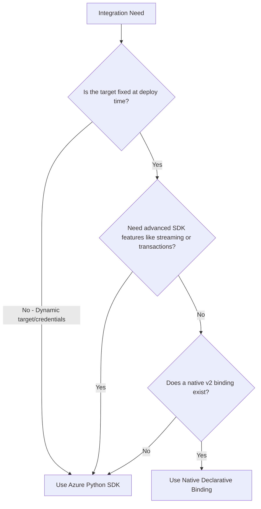

# Azure-Native and Functions-First Execution Model

This guide establishes the execution model and learning progression for the Azure Functions Python Cookbook. It explains how to choose triggers, bindings, and Azure services based on real workload characteristics rather than generic HTTP wrappers or bloated architecture diagrams.

---

## Core Architectural Principles

When designing applications on Azure Functions with Python v2, adhere to five core design principles:

### 1. Functions-First, Not HTTP-First
Treat Azure Functions as an event-driven execution model, not simply as a web server framework:
- **Request / Response**: Use the HTTP trigger (`@app.route`) only when a caller expects a synchronous response within normal interactive timeouts.
- **Reliable Background Work**: Offload tasks to Queue Storage or Service Bus triggers (`@app.queue_trigger`, `@app.service_bus_queue_trigger`).
- **Ordered / FIFO Processing**: Use Service Bus Sessions (`is_sessions_enabled=True`) when message ordering or partition affinity is required.
- **File & Object Events**: Use Event Grid-backed Blob triggers (`@app.blob_trigger(source="EventGrid")`) to react efficiently to blob creations without polling latency.
- **Database Change Tracking**: Use the Cosmos DB trigger (`@app.cosmos_db_trigger`) to react to document change feeds.
- **Scheduled Maintenance**: Use the Timer trigger (`@app.timer_trigger`) for recurring automation.
- **Long-Running / Stateful Workflows**: Use Durable Functions (`@bp.orchestration_trigger`) for multi-step orchestrations, fan-out/fan-in, or human approval.
- **Streaming & Realtime**: Use Server-Sent Events (SSE) or SignalR bindings only where runtime hosting limits allow.

### 2. Azure-Native, Not Azure-Maximalist
Do not add cloud services merely to make an architecture diagram look "more Azure":
- Prefer **Managed Identity (Entra ID)** and role-based access control (RBAC) over static connection strings or access keys.
- Use **Key Vault references** (`@Microsoft.KeyVault(...)`) in application settings for external third-party secrets that cannot use Managed Identity directly.
- Use **Application Insights** and distributed OpenTelemetry correlation instead of verbose custom logging infrastructure.
- Introduce **API Management (APIM)** at the external ingress edge when policy enforcement, rate limiting, or API versioning is genuinely needed.

### 3. Composition Over Duplication
Reuse existing recipe patterns rather than inventing monolithic sample applications:
- Compose specialized recipes (such as Service Bus workers, Blob handlers, or Vector Search) rather than building all-in-one prototypes.
- Document integration handoffs clearly across recipes.

### 4. Toolkit Packages Keep Their Boundaries
The companion packages in the Azure Functions Python DX Toolkit maintain strict separation of concerns:
- `azure-functions-langgraph` is a runtime adapter enabling compiled LangGraph execution on Azure Functions. Prompts, tools, and application logic belong in recipes.
- `azure-functions-validation`, `azure-functions-openapi`, `azure-functions-logging`, and `azure-functions-db` provide focused utilities; do not reimplement them inside recipes.

### 5. Production Path is Explicit but First-Run Stays Small
- Provide zero-credential or emulator-friendly local baselines (using Azurite, local emulators, or deterministic mock modes).
- Clearly distinguish the **baseline required components** from **production upgrades** (such as Managed Identity, Key Vault, VNet integration, and APIM).

---

## Workload Decision Matrix

Use this matrix to identify the appropriate trigger, binding, and recipe starting point based on workload shape:

| Workload Shape | Optimal Trigger / Model | Connected Azure Service | Declarative Binding vs. SDK | Representative Recipe |
| --- | --- | --- | --- | --- |
| Synchronous API / Webhook | HTTP Trigger | API Management / Front Door | HTTP Input / Output | [Hello HTTP Minimal](../patterns/apis-and-ingress/hello-http-minimal.md), [Webhook GitHub](../patterns/apis-and-ingress/webhook-github.md) |
| Async Job Handoff | HTTP Trigger $\rightarrow$ Queue Output | Storage Queue / Service Bus | Output Binding | [Queue-Backed Job](../patterns/async-apis-and-jobs/queue-backed-job.md), [Async HTTP 202 Polling](../patterns/async-apis-and-jobs/async-http-202-polling.md) |
| Decoupled Worker Task | Queue / Service Bus Trigger | Storage Queue / Service Bus | Trigger + Output Binding | [Service Bus Worker](../patterns/messaging-and-pubsub/servicebus-worker.md), [Queue Consumer](../patterns/messaging-and-pubsub/queue-consumer.md) |
| Strict FIFO Messaging | Service Bus Sessions Trigger | Service Bus Queue/Topic | Trigger Binding | [Service Bus Sessions](../patterns/messaging-and-pubsub/servicebus-sessions.md) |
| Broadcast / Multi-consumer | Service Bus Topic Trigger | Service Bus Topics & Subscriptions | Trigger + Output Binding | [Service Bus Topic Fanout](../patterns/messaging-and-pubsub/servicebus-topic-fanout.md) |
| File / Object Ingestion | Event Grid Blob Trigger | Blob Storage + Event Grid | Trigger Binding | [Blob Event Grid Trigger](../patterns/blob-and-file-triggers/blob-eventgrid-trigger.md) |
| Change Stream / Projections | Cosmos DB Trigger | Cosmos DB Change Feed | Trigger + Output Binding | [Change Feed Processor](../patterns/data-and-pipelines/change-feed-processor.md), [CQRS Read Projection](../patterns/data-and-pipelines/cqrs-read-projection.md) |
| Periodic Automation | Timer Trigger | Internal Cron Schedule | Trigger Binding | [Timer Cron Job](../patterns/scheduled-and-background/timer-cron-job.md) |
| Stateful Multi-Step Workflow | Durable Orchestrator | Durable Task Hub (Storage) | Durable Triggers / Client | [Durable Hello Sequence](../patterns/orchestration-and-workflows/durable-hello-sequence.md), [Durable Fan-Out Fan-In](../patterns/orchestration-and-workflows/durable-fan-out-fan-in.md) |
| Human Interaction / Approval | Durable Orchestration + External Event | Durable Task Hub | Durable Orchestration Trigger | [Durable Human Interaction](../patterns/orchestration-and-workflows/durable-human-interaction.md) |
| Interactive AI Assistant | HTTP Trigger (`LangGraphApp`) | Azure OpenAI | Python SDK / LangGraph Adapter | [Personal LangGraph Agent](../patterns/ai-and-agents/personal-langgraph-agent.md), [OpenAI Direct Chat](../patterns/ai-and-agents/openai-direct-chat.md) |
| Grounded RAG Knowledge API | HTTP Trigger | Azure OpenAI + Azure AI Search | Python SDK (`azure-search-documents`) | [RAG Knowledge API](../patterns/ai-and-agents/rag-knowledge-api.md), [LangGraph RAG Agent](../patterns/ai-and-agents/langgraph-rag-agent.md) |
| Keyless Cloud Integration | Any Trigger | Azure Storage / Service Bus / Key Vault | Identity-based connection (`__fullyQualifiedNamespace`) | [Managed Identity Storage](../patterns/security-and-tenancy/managed-identity-storage.md), [Secretless Key Vault](../patterns/security-and-tenancy/secretless-keyvault.md) |

---

## When to Choose Bindings vs. Direct SDKs

A common question in Azure Functions development is whether to use declarative bindings or the official Azure SDK for Python:



### Choose Declarative Bindings When:
- The target queue, blob path, or database collection is static or resolved via route/binding data tokens (e.g. `path="uploads/{name}"`).
- You want the Azure Functions scale controller to automatically manage connection pooling, batching, message settlement (auto-complete), and scaling.
- You want clean, minimal function signatures without client initialization boilerplate.

### Choose Direct SDKs When:
- Destination resources, container names, or connection targets are determined dynamically at runtime based on payload contents.
- You require client-side transactions, atomic multi-document operations, or custom retry policies beyond what the host runtime provides.
- The service does not have an official Functions binding in Python v2 (e.g., Azure AI Search, Azure OpenAI, Redis, or Key Vault secret reading).
- See [Output Binding vs SDK](../patterns/runtime-and-ops/output-binding-vs-sdk.md) for a hands-on comparison.

---

## 5 Guided Learning Paths

These learning paths provide structured routes through existing cookbook recipes:

### 1. AI & Agents Path

This path traces the progression from simple prompt invocation to stateful, event-driven, and orchestrated agents:


1. **Direct HTTP Chat**: Start with direct model invocation over an HTTP trigger ([Azure OpenAI Direct Chat](../patterns/ai-and-agents/openai-direct-chat.md)).
2. **LangGraph Agent on Functions**: Wrap compiled graph logic in a function app using the `LangGraphApp` adapter ([LangGraph Agent](../patterns/ai-and-agents/langgraph-agent.md)).
3. **Thread Memory & Restart-Safe Checkpoints**: Add per-conversation memory backed by Azure Blob Storage checkpointers ([Personal LangGraph Agent](../patterns/ai-and-agents/personal-langgraph-agent.md)).
   > [!NOTE]
   > `thread_id` manages conversation state partition; it does not replace authenticated user authorization. Always validate tenant and caller identity.
4. **Knowledge Retrieval (RAG)**: Connect vector search to ground responses with external knowledge ([RAG Knowledge API](../patterns/ai-and-agents/rag-knowledge-api.md) and [Embedding Vector Search](../patterns/ai-and-agents/embedding-vector-search.md)).
5. **Event-Driven Agent Processing**: When agent execution time is variable or backgrounded, ingest requests via Service Bus queues instead of holding HTTP connections open ([Service Bus Worker](../patterns/messaging-and-pubsub/servicebus-worker.md)).
6. **Durable Agent Workflow with Approval**: Wrap multi-step LLM operations in Durable Functions activities, using external events for human approval and built-in timers for bounded timeouts ([Durable AI Pipeline](../patterns/ai-and-agents/durable-ai-pipeline.md) and [Durable Human Interaction](../patterns/orchestration-and-workflows/durable-human-interaction.md)).
7. **Production Edge, Identity & Observability**: Layer APIM at the edge ([APIM Function Backend](../patterns/apis-and-ingress/apim-function-backend.md)), Entra ID identity ([EasyAuth Claims Extraction](../patterns/apis-and-ingress/auth-easyauth-claims.md)), Keyless Managed Identity ([Managed Identity Storage](../patterns/security-and-tenancy/managed-identity-storage.md)), and OpenTelemetry tracing ([Observability Tracing](../patterns/runtime-and-ops/observability-tracing.md)).

---

### 2. Event-Driven Workloads Path

Master scalable, resilient asynchronous message processing:

1. **Basic Queue Consumer**: Learn queue polling, batching, and auto-settlement ([Queue Consumer](../patterns/messaging-and-pubsub/queue-consumer.md)).
2. **Enterprise Service Bus Worker**: Upgrade to enterprise messaging with peek-lock, dead-lettering, and automatic retries ([Service Bus Worker](../patterns/messaging-and-pubsub/servicebus-worker.md)).
3. **Ordered Session Processing**: Guarantee FIFO ordering within domain entities using Service Bus Sessions ([Service Bus Sessions](../patterns/messaging-and-pubsub/servicebus-sessions.md)).
4. **Pub/Sub Topic Fan-Out**: Distribute messages across multiple independent subscriber functions ([Service Bus Topic Fanout](../patterns/messaging-and-pubsub/servicebus-topic-fanout.md)).
5. **Dead-Letter Replay & Poison Handling**: Safely triage, analyze, and replay failed messages ([Service Bus DLQ Replay](../patterns/messaging-and-pubsub/servicebus-dlq-replay.md) and [Poison Message Handling](../patterns/reliability/poison-message-handling.md)).
6. **Idempotent Settlement**: Protect downstream systems against at-least-once message delivery duplicates ([Retry and Idempotency](../patterns/reliability/retry-and-idempotency.md)).

---

### 3. Data & File Processing Path

Build reactive pipelines for files, databases, and analytics:

1. **Direct Blob Trigger**: React to files written to storage containers ([Blob Upload Processor](../patterns/blob-and-file-triggers/blob-upload-processor.md)).
2. **Event Grid Blob Trigger**: Scale to high-volume blob arrivals using low-latency Event Grid notifications ([Blob Event Grid Trigger](../patterns/blob-and-file-triggers/blob-eventgrid-trigger.md)).
3. **ETL & Transformation**: Parse incoming structured files (e.g., CSV) and store normalized records downstream ([Blob CSV to Table](../patterns/blob-and-file-triggers/blob-csv-to-table.md) and [File Processing Pipeline](../patterns/data-and-pipelines/file-processing-pipeline.md)).
4. **Reactive Database Change Feeds**: Detect and stream database mutations without polling overhead ([Change Feed Processor](../patterns/data-and-pipelines/change-feed-processor.md)).
5. **CQRS Read Projections**: Update read-optimized view stores whenever command side updates occur ([CQRS Read Projection](../patterns/data-and-pipelines/cqrs-read-projection.md)).

---

### 4. Async APIs & Jobs Path

Decouple client request handling from long-running backend compute:

1. **HTTP 202 Polling Pattern**: Return immediate `202 Accepted` with a status polling URI for long client requests ([Async HTTP 202 Polling](../patterns/async-apis-and-jobs/async-http-202-polling.md)).
2. **Queue-Backed Deferred Job**: Accept inbound work items onto a durable queue, releasing the HTTP worker immediately ([Queue-Backed Job](../patterns/async-apis-and-jobs/queue-backed-job.md)).
3. **Durable Async Job Lifecycle**: Track complex jobs with status endpoints, cancellation, and external completion notifications ([Async Job Lifecycle](../patterns/orchestration-and-workflows/async-job-lifecycle.md)).

---

### 5. Production Operations & Hardening Path

Layer enterprise capabilities onto a working function baseline:

```
[ Working Function App ]
           │
           ▼
[ Layer 1: Edge & Gateway ] ───────► API Management (APIM Function Backend)
           │
           ▼
[ Layer 2: Caller Authentication ] ──► EasyAuth / JWT Bearer Validation
           │
           ▼
[ Layer 3: Resource Identity ] ────► Managed Identity & Secretless Key Vault
           │
           ▼
[ Layer 4: Observability & Audit ] ─► OpenTelemetry & Application Insights Tracing
           │
           ▼
[ Layer 5: Fault Tolerance ] ──────► host.json Tuning & Circuit Breakers
```

- **Edge Gateway**: Isolate function backends behind APIM for rate limiting and policy enforcement ([APIM Function Backend](../patterns/apis-and-ingress/apim-function-backend.md)).
- **Caller Authentication**: Enforce token validation and extract identity claims ([EasyAuth Claims Extraction](../patterns/apis-and-ingress/auth-easyauth-claims.md) and [JWT Bearer Validation](../patterns/apis-and-ingress/auth-jwt-validation.md)).
- **Resource Identity**: Eliminate connection strings using Managed Identity ([Managed Identity Storage](../patterns/security-and-tenancy/managed-identity-storage.md), [Managed Identity Service Bus](../patterns/security-and-tenancy/managed-identity-servicebus.md), and [Secretless Key Vault](../patterns/security-and-tenancy/secretless-keyvault.md)).
- **Observability**: Implement distributed request and correlation tracking ([Observability Tracing](../patterns/runtime-and-ops/observability-tracing.md)).
- **Host Tuning**: Tune concurrency, worker processes, and cold-start parameters ([host.json Tuning](../patterns/runtime-and-ops/host-json-tuning.md) and [Concurrency Tuning](../patterns/runtime-and-ops/concurrency-tuning.md)).
