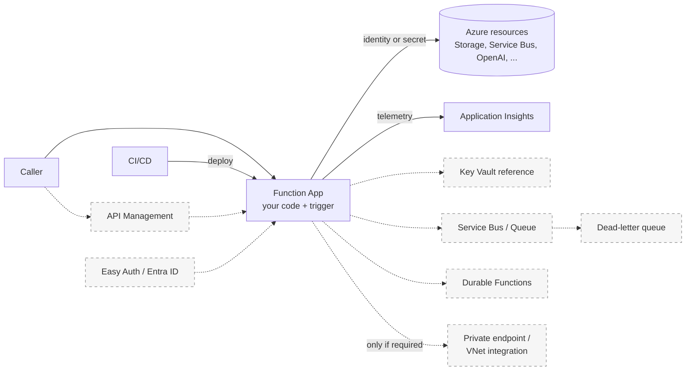

# Production upgrade path

> **I have a working Function. What should I add before production?**

This page is a **decision guide**, not a template and not a deployment. It starts from a Function
App that already works and lists the capabilities you may add, by concern. Almost none are
mandatory. Pick the rows where your answer to **Use when** is yes, and skip the rest.

Nothing on this page was deployed, load-tested or certified by this repository. Azure behavior is
described from the cited Microsoft Learn pages; recipe behavior is described from each recipe's
own `verification` level (see [Release and version trust](#release-and-version-trust)).

## Decision summary

Baseline items apply to nearly every production Function. Everything in the second table is
**only when your situation requires it**.

### Baseline: do these first

| Concern | Baseline recommendation | Start from |
| --- | --- | --- |
| Caller access | Do not leave an HTTP route `anonymous` unless it is meant to be public; know what a function key does and does not prove. | [HTTP Auth Levels](../patterns/apis-and-ingress/http-auth-levels.md), [Anonymous endpoints](../anonymous-endpoints.md) |
| Secrets | Keep secrets out of code. Prefer identity-based connections; otherwise app settings, optionally Key Vault references. | [Identity-based connections](../guides/identity-based-connections.md), [Secretless Key Vault](../patterns/security-and-tenancy/secretless-keyvault.md) |
| Observability | Connect Application Insights; log correlation IDs and outcomes, not payloads or credentials. | [Observability Tracing](../patterns/runtime-and-ops/observability-tracing.md) |
| Failure handling | Know your trigger's retry behavior and make handlers safe to run twice. | [Retry and Idempotency](../patterns/reliability/retry-and-idempotency.md), [Delivery guarantees](delivery-guarantees.md) |
| Deployment | Deploy from CI with a rollback plan; choose the hosting plan on purpose. | [Deployment Patterns](../guides/deployment-patterns.md), [Hosting and scale](hosting-and-scale.md) |

### Add when needed

| Capability | Add it when | Skip it when | Example |
| --- | --- | --- | --- |
| API Management in front | Many APIs need one gateway posture: JWT checks, throttling, versioned exposure | One internal API with a single caller | [APIM Function Backend](../patterns/apis-and-ingress/apim-function-backend.md) |
| Easy Auth (Entra ID) | Users sign in and the platform should authenticate them before your code runs | Callers are services holding a different credential, or you validate tokens yourself | [EasyAuth Claims](../patterns/apis-and-ingress/auth-easyauth-claims.md) |
| App-level JWT / tenant authorization | Authorization depends on claims, tenant or role | Access is all-or-nothing for a trusted caller | [JWT Validation](../patterns/apis-and-ingress/auth-jwt-validation.md), [Multi-Tenant Auth](../patterns/apis-and-ingress/auth-multitenant.md) |
| Key Vault references | A secret cannot be replaced by an identity (third-party API key, signing key) | Every dependency supports identity-based access | [Secretless Key Vault](../patterns/security-and-tenancy/secretless-keyvault.md) |
| Queue / Service Bus between caller and work | The caller should not wait; work can be retried later | The caller needs the answer in the same request and it is fast | [Service Bus Worker](../patterns/messaging-and-pubsub/servicebus-worker.md), [Queue-Backed Job](../patterns/async-apis-and-jobs/queue-backed-job.md) |
| Dead-letter handling and replay | Messages can fail permanently and someone must inspect them | Failures are transient and loss is acceptable | [Service Bus DLQ Replay](../patterns/messaging-and-pubsub/servicebus-dlq-replay.md), [Poison Message Handling](../patterns/reliability/poison-message-handling.md) |
| Durable Functions | Work spans many steps, waits for people, or needs fan-out/fan-in with state | One short, stateless step | [Durable Fan-out/Fan-in](../patterns/orchestration-and-workflows/durable-fan-out-fan-in.md), [Durable Human Interaction](../patterns/orchestration-and-workflows/durable-human-interaction.md) |
| Private endpoint / VNet integration | A dependency or caller is only reachable privately, or policy forbids a public endpoint | Public endpoint plus identity meets your requirement | [Networking](#networking) |
| Persistent checkpoints for an agent | An agent must remember across restarts or instances | Each request is independent | [Personal LangGraph Agent](../patterns/ai-and-agents/personal-langgraph-agent.md) |

Do not read the second table as a checklist. A Function with none of these rows can be a
legitimate production workload; a Function with all of them is usually over-built.

## Recipe status is not production readiness

A recipe's difficulty (`Beginner`, `Intermediate`, `Advanced`) describes how hard the code is, not
how production-ready it is. Use these three plain descriptions instead of a new label set:

- **Learning sample**: shows one idea locally. Many recipes bind anonymous routes, keep state in
  memory or simulate processing; their README and [Anonymous endpoints](../anonymous-endpoints.md)
  say so.
- **Building block**: one production concern (for example identity-based Service Bus access or DLQ
  replay) you adapt into your app.
- **Composition example**: several pieces together (for example a LangGraph agent with Azure
  OpenAI and Blob checkpoints).

The classification is a reading aid, not stored metadata. What *is* recorded per recipe is its
`verification` level in `recipe.yaml`, listed in [Toolkit usage by recipe](../toolkit-usage.md).

## Responsibilities diagram

Solid boxes are the baseline. Dashed boxes are conditional upgrades; a real system usually
contains only some of them.

## Edge and API

**Baseline.** Browsers and clients reach the Function App over HTTPS. Microsoft's layered list for
securing HTTP endpoints runs from requiring HTTPS and access keys, through App Service
Authentication, to API Management, virtual networks and isolation
([Secure Azure Functions][security]).

**API Management: Use when** several APIs need consistent JWT validation, throttling and
versioned exposure, or you want the Function App to accept requests only from the APIM instance
(Microsoft documents restricting the app to the APIM IP address; see [security concepts][security]).
**Skip when** you have one internal API and one known caller; APIM adds a service to operate.
**Example:** [APIM Function Backend](../patterns/apis-and-ingress/apim-function-backend.md).
Docs: [Import a function app as an API][apim-import], [validate-jwt][apim-jwt],
[rate-limit][apim-rate], [API versions][apim-versions].

## Caller identity

Four different things get called "auth". Keep them apart:

| Mechanism | What it proves | Note |
| --- | --- | --- |
| Function key | The caller holds a shared secret | Microsoft: keys make endpoints harder to reach, but "the only way to truly secure your function endpoints is by implementing positive authentication of clients" ([security concepts][security]). Not a per-user identity. |
| Easy Auth with Entra ID | The platform authenticated a user or client before your code | Built into App Service and Functions ([Authentication and authorization][easyauth]). Configure it deliberately; recipe behavior is in [EasyAuth Claims](../patterns/apis-and-ingress/auth-easyauth-claims.md). |
| JWT / application authorization | Your code (or APIM) validated a token and decided what the claims may do | [JWT Validation](../patterns/apis-and-ingress/auth-jwt-validation.md), [Multi-Tenant Auth](../patterns/apis-and-ingress/auth-multitenant.md) |
| Service-to-service identity | A calling service authenticates with its own identity and you authorize that identity | No dedicated cookbook recipe covers the calling side; see Microsoft's [authentication scenarios][scenarios]. Identity for *resources your Function calls* is under [Resource identity](#resource-identity). |

Thread IDs, session IDs and similar partition keys (agents, Service Bus) are **not** identity.
See [Personal LangGraph Agent](../patterns/ai-and-agents/personal-langgraph-agent.md).

## Resource identity

**Baseline.** Prefer identity-based connections for supported triggers and bindings, so there is
no secret to rotate and access is auditable by role. Microsoft's list of supported services and the
RBAC roles each trigger or binding needs is in [Manage connections][connections]; it also covers
the host-required `AzureWebJobsStorage` connection.

- Storage, Queue, Blob, Service Bus, Event Hubs and others: configure the `<CONNECTION>__...`
  settings and assign the listed roles. See [Identity-based connections](../guides/identity-based-connections.md),
  [Managed Identity Storage](../patterns/security-and-tenancy/managed-identity-storage.md) and
  [Managed Identity Service Bus](../patterns/security-and-tenancy/managed-identity-servicebus.md).
- Azure OpenAI from code: use Entra ID with an Azure OpenAI role such as **Cognitive Services
  OpenAI User** ([Azure OpenAI RBAC][aoai-rbac]) instead of an API key; recipe example:
  [Personal LangGraph Agent](../patterns/ai-and-agents/personal-langgraph-agent.md).
- Verify roles and support per service in Microsoft's documentation; this page does not list roles
  for services it did not check (for example Cosmos DB and AI Search use their own data-plane
  access models).

**Key Vault references: Use when** a secret cannot be eliminated. **Skip when** the dependency
supports identity. A Key Vault reference replaces a connection string or key in an app setting
([security concepts][security]). Example: [Secretless Key Vault](../patterns/security-and-tenancy/secretless-keyvault.md).

Also from Microsoft: run with least privilege, consider separate function apps when functions need
different credentials, restrict CORS to specific origins, and consider disabling the `/admin`
endpoints ([security concepts][security]).

## Background and long-running work

| Need | Use | Example |
| --- | --- | --- |
| Caller does not wait; independent items | Queue or Service Bus trigger | [Queue-Backed Job](../patterns/async-apis-and-jobs/queue-backed-job.md), [Service Bus Worker](../patterns/messaging-and-pubsub/servicebus-worker.md) |
| Caller starts work and polls | HTTP 202 and a status route | [Async HTTP 202 Polling](../patterns/async-apis-and-jobs/async-http-202-polling.md) |
| Multi-step, waiting, or fan-out/fan-in | Durable Functions | [Durable Fan-out/Fan-in](../patterns/orchestration-and-workflows/durable-fan-out-fan-in.md) ([overview][durable]) |

Start with the simplest row that fits. Durable Functions is for state across steps, not a default.

## Reliability

Retry and dead-letter behavior depends on the trigger, so decide per trigger, not globally.
Microsoft's [error handling and retries][retries] lists, per trigger, whether retries come from the
binding extension or from a function-level retry policy, and advises designing for idempotency so repeated messages do not corrupt data. [Designing for identical input][idempotent] lists idempotency techniques
(existence checks, deduplication, guard logic, concurrency control).

- Retry and idempotency: [Retry and Idempotency](../patterns/reliability/retry-and-idempotency.md)
- Poison and dead-letter: [Poison Message Handling](../patterns/reliability/poison-message-handling.md),
  [Service Bus DLQ Replay](../patterns/messaging-and-pubsub/servicebus-dlq-replay.md)
- Delivery semantics: [Delivery guarantees](delivery-guarantees.md)

## Observability

Application Insights integration is built into Azure Functions ([monitoring][monitoring]); a
connection string configures it. For OpenTelemetry on Python, Microsoft documents app settings that
let the Python worker stream OpenTelemetry telemetry ([OpenTelemetry in Azure Functions][otel]).

- Correlate by IDs that identify an invocation, message, job, orchestration instance or agent run.
- Log outcomes and sizes. Do **not** log prompts, message bodies, tokens or connection strings by
  default; add payload logging only with an explicit retention decision.
- Sampling is on by default in Application Insights and can hide events ([monitoring][monitoring]).

Recipe: [Observability Tracing](../patterns/runtime-and-ops/observability-tracing.md) (HTTP
request tracing; message and orchestration tracing is not what that recipe demonstrates).

## State and data

- **What you store, you own.** Checkpoints, job rows and blobs persist until you remove them. Decide
  retention and deletion before storing real user data; Blob Storage offers
  [lifecycle management][lifecycle].
- **Thread or session ownership.** A thread ID separates state; it does not authorize access. If
  several users can reach a graph or queue, enforce who may use which thread outside the ID.
- **Checkpoint limits.** In-process checkpointers are per instance and lost on restart. Durable
  checkpointers need a lock strategy when several writers can touch one thread; the Personal
  LangGraph Agent recipe documents its lock and states it does not promise exactly-once tool
  effects.
- **Cleanup.** Delete test resource groups, containers and local emulator data when done.

## Networking

There is no single correct topology. Decide by requirement:

| Requirement | Option | Check |
| --- | --- | --- |
| Public endpoint, authenticate callers, restrict sources | Access restrictions plus identity | [Networking options][network] |
| Function must be reachable only on a private IP | Private endpoint for the app | Supported on Flex Consumption, Elastic Premium and Dedicated; **not** on the Consumption plan, per [Networking options][network] |
| Function must reach private or subnet-restricted resources | Virtual network integration (outbound) | Same page: supported on Flex Consumption, Elastic Premium and Dedicated; not on Consumption. It affects outbound traffic only. |

Whether a public endpoint plus authenticated callers and identity-based access is enough depends on
your requirements; Microsoft names securing the whole architecture inside a virtual network as the
highest-security option ([security concepts][security]). Add private networking when a dependency or
policy requires it, and choose the hosting plan with that support in mind ([hosting options][scale]). The cookbook does not ship a networking
recipe; use Microsoft's guidance, for example [Integrate Azure Functions with a virtual network
using private endpoints][vnet].

## Deployment and rollback

Follow [Deployment Patterns](../guides/deployment-patterns.md) for CI/CD, app settings and
rollback. Microsoft notes that deployment slots depend on the hosting plan, and that Flex
Consumption does not support slots and uses [site update strategies][flexupdate] instead
([deployment slots][slots]). Choose the plan and its release strategy together. This repository
does not run a deployment of any recipe in CI (see below).

## Release and version trust

- **`main` is moving development content.** A **tagged GitHub Release** is a reproducible snapshot.
  To find and check out the snapshot to use, follow
  [Versions, snapshots, and verification](../snapshots-and-verification.md); it points to the
  GitHub Releases page rather than repeating a version number, and so does this page. Release UX is
  tracked in [#354](https://github.com/yeongseon/azure-functions-cookbook-python/issues/354);
  inventory and release-history drift in [#353](https://github.com/yeongseon/azure-functions-cookbook-python/issues/353).
- **CI passing is not production certification.** Look up the recipe's own level
  (`docs`, `unit`, `func-host`, `azure`) in [Toolkit usage by recipe](../toolkit-usage.md) and read
  what that level covers in [Stability and compatibility](../stability-and-compatibility.md). No
  required check deploys to Azure, so identity, RBAC, networking and scale behavior are unverified
  here unless a recipe documents otherwise.

## Related

- [Pattern Chooser](pattern-chooser.md): pick a starting category.
- [Hosting and scale](hosting-and-scale.md), [Execution model](execution-model.md)
- Out of scope: an enterprise landing zone, an infrastructure framework, or one sample containing every
  Azure service. Use Microsoft's architecture and security documentation for those.

[security]: https://learn.microsoft.com/azure/azure-functions/security-concepts
[easyauth]: https://learn.microsoft.com/azure/app-service/overview-authentication-authorization
[connections]: https://learn.microsoft.com/azure/azure-functions/manage-connections
[aoai-rbac]: https://learn.microsoft.com/azure/ai-foundry/openai/how-to/role-based-access-control
[apim-import]: https://learn.microsoft.com/azure/api-management/import-function-app-as-api
[apim-jwt]: https://learn.microsoft.com/azure/api-management/validate-jwt-policy
[apim-rate]: https://learn.microsoft.com/azure/api-management/rate-limit-policy
[apim-versions]: https://learn.microsoft.com/azure/api-management/api-management-get-started-publish-versions
[scenarios]: https://learn.microsoft.com/azure/app-service/identity-scenarios
[durable]: https://learn.microsoft.com/azure/azure-functions/durable/durable-functions-overview
[retries]: https://learn.microsoft.com/azure/azure-functions/functions-bindings-error-pages
[idempotent]: https://learn.microsoft.com/azure/azure-functions/functions-idempotent
[monitoring]: https://learn.microsoft.com/azure/azure-functions/functions-monitoring
[otel]: https://learn.microsoft.com/azure/azure-functions/opentelemetry-howto
[lifecycle]: https://learn.microsoft.com/azure/storage/blobs/lifecycle-management-overview
[network]: https://learn.microsoft.com/azure/azure-functions/functions-networking-options
[scale]: https://learn.microsoft.com/azure/azure-functions/functions-scale
[vnet]: https://learn.microsoft.com/azure/azure-functions/functions-create-vnet
[slots]: https://learn.microsoft.com/azure/azure-functions/functions-deployment-slots
[flexupdate]: https://learn.microsoft.com/azure/azure-functions/flex-consumption-site-updates
