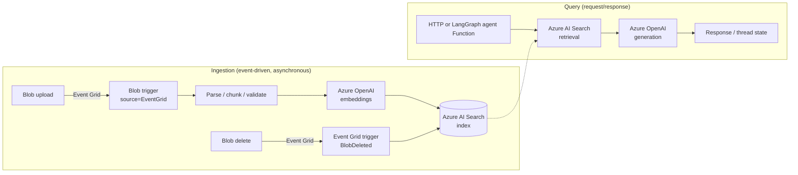

# Azure RAG Path: Blob Events to Azure AI Search to an Agent

> **Type**: composition guide | **Difficulty**: advanced | **Verification**: the one new piece of code ([Blob RAG Ingestion](blob-rag-ingestion.md)) is `unit`; the composition itself has not been run end to end in Azure or on a Functions host.

This page shows how the cookbook's existing RAG-related recipes fit together into one Azure-native
path, which handoffs already work, and which one was missing. It deliberately reuses the existing
recipes instead of adding another all-in-one RAG application.

## Target architecture

Ingestion and query are separate Function code paths. A slow or failing ingestion invocation runs
on its own trigger and retry budget and does not occupy HTTP request handling. They can share one
Function app (as the diagram implies) or be split into two apps; splitting also gives each its own
scaling and identity boundary.

## Audit: which handoffs already work

Findings come from reading each recipe's code in this repository.

| Step | Existing recipe | What the code actually does | Handoff status |
| --- | --- | --- | --- |
| Blob event to Function | [Blob Event Grid Trigger](../blob-and-file-triggers/blob-eventgrid-trigger.md) (`blob-and-file-triggers`) | Event Grid-sourced blob trigger; logs the blob name and size and returns. It does not read, chunk or embed content. | Works; ends at the trigger. |
| Chunk, embed, write to index | none before this change | No recipe writes documents to an Azure AI Search index. | **Missing**, now covered by [Blob RAG Ingestion](blob-rag-ingestion.md). |
| Vector query | [Embedding Vector Search](embedding-vector-search.md) | Embeds the query with Azure OpenAI and runs a vector query on `content_vector` (selecting `id`, `title`, `content`). Uses API-key settings (`AZURE_OPENAI_KEY`, `AI_SEARCH_KEY`) and returns one canned document when they are unset. Retrieval only; no answer generation. | Field names match what Blob RAG Ingestion writes (by inspection; not run together). |
| Knowledge API | [RAG Knowledge API](rag-knowledge-api.md) | `/ingest` appends to an in-memory list and `/ask` returns a canned answer built from it: a local fallback client only, no Azure AI Search or Azure OpenAI calls. | Demonstrates the HTTP/validation shape, not the Azure integration. |
| Agent retrieval | [LangGraph RAG Agent](langgraph-rag-agent.md) | A routing graph whose `_build_knowledge_client()` returns `None`, so `search_knowledge()` always serves canned `mock://` results. It is an extension point, not a working Azure AI Search client. | Replace `_build_knowledge_client()` with a real retrieval client (see below). |

Remaining gap, intentionally not filled here: no recipe performs grounded answer generation over
retrieved chunks with Azure OpenAI, and the query-side recipes above still need their retrieval
wired to the index that ingestion produces. Per the scope of this guide, that wiring stays with the
individual query recipes rather than a new monolith.

### Connecting the query side

The vector query in [Embedding Vector Search](embedding-vector-search.md) (`_vector_search`) is the
reference for retrieval. To make the agent grounded, implement a client with a `search(query=...,
top_k=...)` method that does the same call and return it from `_build_knowledge_client()` in
[LangGraph RAG Agent](langgraph-rag-agent.md); `search_knowledge()` already tries `search`, `query`
and `retrieve` methods and normalizes `title`/`content`/`source` fields. Chunks written by Blob RAG
Ingestion carry `title`, `content` and `source`.

## Why events instead of polling

The Blob trigger has two implementations. The event-based one (`source=EventGrid`) is the
recommended one and has lower latency; the polling-based one has higher latency. The Flex
Consumption plan supports only the event-based implementation, and a storage account with a
hierarchical namespace (for example Data Lake Storage Gen2) must use it
([Blob trigger reference](https://learn.microsoft.com/en-us/azure/azure-functions/functions-bindings-storage-blob-trigger)).
Event subscriptions need a general-purpose v2 storage account, and the Storage extension must be 5.x
or later (extension bundle at least 3.3.0)
([tutorial](https://learn.microsoft.com/en-us/azure/azure-functions/functions-event-grid-blob-trigger)).

Deletions are a separate event. The trigger reference describes the blob trigger in terms of new or
updated blobs, and Event Grid publishes `Microsoft.Storage.BlobDeleted` when a blob is deleted
([blob event schema](https://learn.microsoft.com/en-us/azure/event-grid/event-schema-blob-storage)),
so the recipe adds an Event Grid trigger for that event.

## Idempotent identifiers and safe reprocessing

Event Grid storage events are delivered at least once; duplicates can occur and events can arrive
out of order ([blob events overview](https://learn.microsoft.com/en-us/azure/storage/blobs/storage-blob-event-overview),
[delivery and retry](https://learn.microsoft.com/en-us/azure/event-grid/delivery-and-retry)). Failed
blob-trigger invocations are retried and then moved to a poison queue
([trigger reference](https://learn.microsoft.com/en-us/azure/azure-functions/functions-bindings-storage-blob-trigger)).
Design for repeats instead of relying on exactly-once:

- **Source id**: `sha256(container/blob name)[:32]`. A hash stays within the Azure AI Search
  document-key alphabet (letters, digits, dash, underscore, equal sign; up to 1,024 characters;
  [naming rules](https://learn.microsoft.com/en-us/rest/api/searchservice/naming-rules)) for any blob name.
- **Chunk id**: `<source id>-<5-digit index>`. Same blob and same chunking give the same ids.
- **Writes** use `mergeOrUpload` ([index update docs](https://learn.microsoft.com/en-us/azure/search/search-howto-reindex)),
  so replays overwrite rather than duplicate.
- **Skip unchanged chunks**: a per-chunk text hash is stored; chunks whose id and hash already match
  are not embedded again, which avoids paying for embeddings on duplicate events.
- **Update order**: write new chunks first, delete stale ones last, so an interruption leaves
  old-plus-new content and a retry converges.

## Deletion and update: what is and is not handled

Handled by the sample: overwrite of an existing blob (changed chunks re-embedded, trailing chunks
removed), deletion of a blob (all its chunks removed by `source_id`), duplicate delete events (a
second delete finds nothing).

**Not handled automatically**, and a simple sample should not be read as handling it:

- Event ordering. A `BlobDeleted` delivered after a re-upload of the same name would delete the new
  chunks. Event Grid exposes `sequencer` and `etag` for ordering
  ([blob events overview](https://learn.microsoft.com/en-us/azure/storage/blobs/storage-blob-event-overview)),
  but the blob trigger does not surface them to the function, so the sample does not compare them.
- Soft delete and blob versions, blob renames or copies, and container deletion.
- Reconciling an index that already drifted (for example after the Function was disabled). Needs a
  periodic reconciliation job.
- Binary formats (PDF, Office), OCR, or semantic chunking. Input is UTF-8 text.
- Per-document security trimming or tenant isolation in the index.
- Event-subscription management, dead-lettering and alerting for failed deliveries.

If you need managed ingestion rather than code you own, Azure AI Search also offers a
[blob indexer](https://learn.microsoft.com/en-us/azure/search/search-how-to-index-azure-blob-storage)
and integrated vectorization
([vector index docs](https://learn.microsoft.com/en-us/azure/search/vector-search-how-to-create-index)).
This cookbook keeps the Function-based path because it is the one that shows Functions triggers.

## Identity and secrets

The recipe uses `DefaultAzureCredential` for Azure OpenAI and Azure AI Search and stores no keys.

| Resource | Role to grant the Function's identity | Source |
| --- | --- | --- |
| Azure OpenAI | Cognitive Services OpenAI User | [role-based access control](https://learn.microsoft.com/en-us/azure/ai-services/openai/how-to/role-based-access-control) |
| Azure AI Search (write) | Search Index Data Contributor | [search RBAC](https://learn.microsoft.com/en-us/azure/search/search-security-rbac) |
| Azure AI Search (query app) | Search Index Data Reader | [search RBAC](https://learn.microsoft.com/en-us/azure/search/search-security-rbac) |

The Azure OpenAI client follows the documented keyless pattern: a bearer-token provider from
`azure.identity` as the client's `api_key`
([managed identity article](https://learn.microsoft.com/en-us/azure/ai-services/openai/how-to/managed-identity)).
The query-side recipes today still read API keys from app settings (`AZURE_OPENAI_KEY`,
`AI_SEARCH_KEY`); move them to the same identity-based pattern for production. Where a key must
remain, reference it from Key Vault instead of embedding it
([Secretless Key Vault](../security-and-tenancy/secretless-keyvault.md)). Put API Management in
front of the external HTTP edge ([APIM Function Backend](../apis-and-ingress/apim-function-backend.md)).
Private networking is not covered by this cookbook path.

## Diagnostics without leaking content

The ingestion Functions log only counts, a hashed source id and the invocation id
(`context.invocation_id`); they never log document text, chunk text, prompts or blob names, and the
tests assert that. Keep it that way when you extend them: failures that need content to debug should
be reproduced with a fixture, not by logging production documents. See
[Observability Tracing](../runtime-and-ops/observability-tracing.md) for correlating a request
across Functions.

## Suggested reading order

1. [Blob Event Grid Trigger](../blob-and-file-triggers/blob-eventgrid-trigger.md): the trigger mechanics.
2. [Blob RAG Ingestion](blob-rag-ingestion.md): chunk, embed, index, update and delete.
3. [Embedding Vector Search](embedding-vector-search.md): the vector query.
4. [LangGraph RAG Agent](langgraph-rag-agent.md): where a retrieval client plugs into an agent.
5. [Agent Learning Path](learning-path.md), Stage 4 and Stage 7: hardening.
