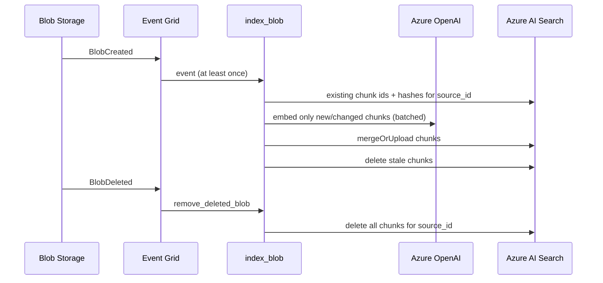

# Blob RAG Ingestion

> **Trigger**: Blob (Event Grid source) + Event Grid | **State**: stateless; the index is the state | **Guarantee**: at-least-once, idempotent | **Difficulty**: advanced | **Verification**: `unit`

## Overview

The ingestion half of the [Azure RAG path](azure-rag-path.md). A blob uploaded to the
`rag-documents` container becomes chunks, Azure OpenAI embeddings and documents in an Azure AI
Search index. A second trigger removes a blob's chunks when the blob is deleted.

It exists because no other recipe in the cookbook writes to an Azure AI Search index: the
[Blob Event Grid Trigger](../blob-and-file-triggers/blob-eventgrid-trigger.md) stops at logging the
blob, and the query-side recipes assume an index already exists.

## When to Use

- You want to see an event-driven, idempotent path from a blob to a vector index in plain Functions code.
- You need to reason about re-delivery, updates and deletes for a RAG index.

## When NOT to Use

- You need PDFs, Office files, OCR or semantic chunking, or managed vectorization. Consider Azure AI Search
  [indexers and integrated vectorization](https://learn.microsoft.com/en-us/azure/search/search-how-to-index-azure-blob-storage).
- You need an answer-generation endpoint. This recipe only builds the index.

## Architecture



> **Maps to** `examples/ai-and-agents/blob_rag_ingestion/`: `index_blob` and `remove_deleted_blob` are in
> `app/functions/ingest.py`; the pure logic is `app/services/ingestion.py`; the Azure adapters are
> `app/services/azure_clients.py`.

## Design decisions

- **Injected clients.** `ingest_document` takes an `Embedder` and a `ChunkStore` protocol, so the
  whole pipeline runs against in-memory fakes. Only `build_services()` creates real clients.
- **Permanent versus transient failures.** A blob that is too large (1,000,000 bytes), not UTF-8, or
  needs more than 200 chunks is logged and dropped; retrying cannot fix it. Any other exception
  (timeouts, throttling, a rejected index write) propagates so the host retries; after the blob
  trigger's retries the message goes to the poison queue
  ([blob trigger reference](https://learn.microsoft.com/en-us/azure/azure-functions/functions-bindings-storage-blob-trigger)).
  These limits are sample defaults, not service limits.
- **Bounded reads.** The handler reads at most the size limit plus one byte, because binding a whole blob
  loads it into memory ([trigger reference](https://learn.microsoft.com/en-us/azure/azure-functions/functions-bindings-storage-blob-trigger)).
- **Per-document results.** Azure AI Search reports per-document failures in the result list; the
  adapter turns any failed document into an exception so the invocation is retried.
- **Identity.** `DefaultAzureCredential` for both services; no keys in settings.

Identifier, update and delete semantics are explained in the
[end-to-end page](azure-rag-path.md#idempotent-identifiers-and-safe-reprocessing).

## Index fields

| Field | Purpose | Index attributes |
| --- | --- | --- |
| `id` | chunk key | key |
| `source_id` | groups the chunks of one blob | filterable |
| `source`, `title`, `chunk_index` | metadata | retrievable |
| `content_hash` | per-chunk text hash | retrievable |
| `content` | chunk text | searchable |
| `content_vector` | embedding | vector field with a profile; dimensions must equal your embedding model's output |

Create the index separately; see
[Azure AI Search vector index](https://learn.microsoft.com/en-us/azure/search/vector-search-how-to-create-index).

## Run

Offline tests (no Azure, network, Azurite or host):

```bash
cd examples/ai-and-agents/blob_rag_ingestion
pip install -e ".[dev]"
pytest
```

Against Azure, copy `local.settings.json.example`, set the Azure OpenAI and Azure AI Search endpoints,
sign in with `az login`, grant the roles listed in the [end-to-end page](azure-rag-path.md#identity-and-secrets),
create an Event Grid subscription for the storage account, and run `func start`. Creating the
subscription for the blob trigger is described in the
[Event Grid blob trigger tutorial](https://learn.microsoft.com/en-us/azure/azure-functions/functions-event-grid-blob-trigger).
For the delete handler, create a subscription for `Microsoft.Storage.BlobDeleted` that targets the
`remove_deleted_blob` function ([Event Grid trigger reference](https://learn.microsoft.com/en-us/azure/azure-functions/functions-bindings-event-grid-trigger)).

## What is verified

| Claim | Evidence |
| --- | --- |
| Chunking, id stability, idempotent re-runs, update and stale-chunk removal, delete, batching, rejection rules, retry convergence | `tests/test_ingestion.py` (fake embedder and store) |
| Handlers parse a blob and a `BlobDeleted` event, drop permanent failures, let transient ones propagate, log no content | `tests/test_functions.py` (fake blob and event objects) |
| Adapters call the SDK clients as designed and raise on per-document failure | `tests/test_azure_clients.py` (fake SDK clients) |
| Binding metadata: Event Grid source and `rag-documents/{name}` path | `tests/test_functions.py` (reads the registered binding) |

**Not verified**: a running Functions host, a real Event Grid subscription, real Azure OpenAI or Azure
AI Search calls, role assignments, or how `BlobDeleted` subjects encode unusual blob names (the
recipe uses the subject as-is). The `verification` level in `recipe.yaml` is therefore `unit`.
