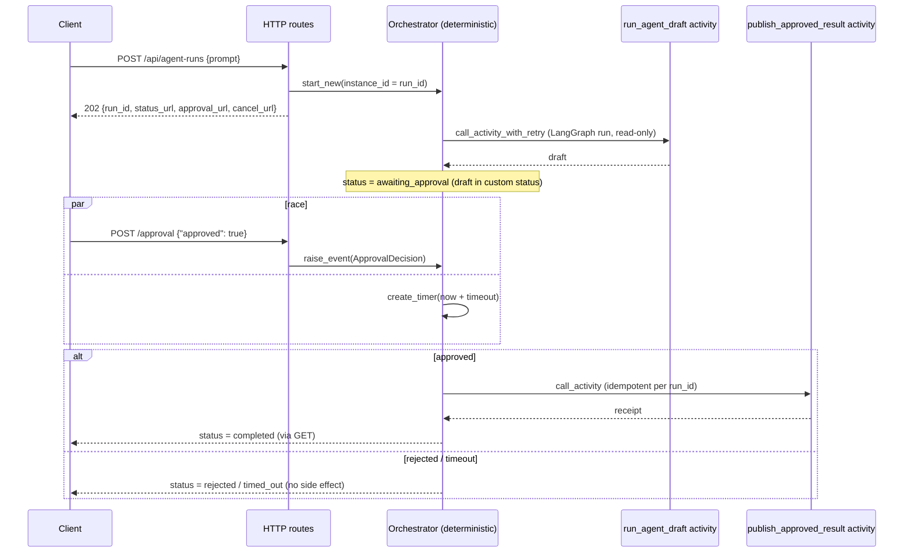

# Durable Agent Approval

> **Trigger**: HTTP + Durable orchestration | **State**: durable workflow | **Guarantee**: at-least-once activities, idempotent completion | **Difficulty**: advanced | **Verification**: `unit`

## Overview

When should an agent request stop being a long HTTP invocation and become a durable workflow? When
the work should outlive the request, needs a human decision, or must be observable and cancellable.
This recipe is that shape: an HTTP starter returns `202`; a Durable orchestrator runs a LangGraph
draft in an **activity**, waits for an approval event with a timeout, and only then runs a final
bounded completion activity.

Durable owns the workflow lifecycle (waiting, timers, retries, status). It does **not** mirror
LangGraph nodes and edges: the whole graph runs inside one activity. Generic Durable explanations
stay in the existing pages, which this one deliberately does not repeat:
[Durable Human Interaction](../orchestration-and-workflows/durable-human-interaction.md) (event +
timer race), [Durable AI Pipeline](durable-ai-pipeline.md) (multi-step AI activities) and
[Async Job Lifecycle](../orchestration-and-workflows/async-job-lifecycle.md) (status/cancel
lifecycle). For a packaged create/poll/cancel adapter over a graph, see the
`azure-functions-langgraph` Durable async run support (a separate, experimental feature; this recipe
does not use it).

## When to Use

- The agent step can take long enough to risk an HTTP client or gateway timeout.
- A person must approve the result before a side effect happens, and "no answer" must mean "no action".
- Callers need status, cancellation and an explicit failure path.

## When NOT to Use

- The draft returns within an interactive request: use [Azure OpenAI Direct Chat](openai-direct-chat.md)
  or the [LangGraph Agent](langgraph-agent.md) route.
- You need Service Bus ingress, multi-agent orchestration or a general workflow engine (out of scope).

## Architecture

> **Maps to** `examples/ai-and-agents/durable_agent_approval/`: routes and orchestrator in
> `app/functions/workflow.py`; pure rules in `app/services/workflow.py`; the LangGraph graph and
> model adapters in `app/services/agent.py`; all bounds in `app/core/limits.py`.

## Determinism and replay

The orchestrator is re-executed from the start whenever it wakes up, replaying recorded results
instead of repeating work
([orchestrations](https://learn.microsoft.com/en-us/azure/azure-functions/durable/durable-functions-orchestrations)),
so its code must be deterministic
([code constraints](https://learn.microsoft.com/en-us/azure/azure-functions/durable/durable-functions-code-constraints)).
In this recipe that means:

- **No model, graph, network, file, environment, clock, random or UUID access in the orchestrator.**
  Time comes from `context.current_utc_datetime`; the run id is `context.instance_id`; everything
  else is an activity.
- **Logs from the orchestrator are guarded by `context.is_replaying`**, otherwise each replay would
  repeat the line. Model calls and detailed logging belong in activities, which run once per
  attempt, not once per replay.
- The timeout is clamped inside the orchestrator from replayed input, so a replay computes the same deadline.

Tests enforce these rules three ways (see [What is verified](#what-is-verified)): an AST guard over
the orchestrator's identifiers, patched `time`/`random`/`uuid` that raise if touched, and replaying
identical history through the real SDK and requiring identical actions.

## Approval, timeout and the race

`wait_for_external_event` and `create_timer` race through `task_any`; the timer is cancelled when
the event wins, the same pattern as the
[timers documentation](https://learn.microsoft.com/en-us/azure/azure-functions/durable/durable-functions-timers).
Safe-by-default rules:

- Only an explicit `{"approved": true}` publishes. Rejection, a missing/odd payload, or a timeout never does.
- The approval route returns `409` unless the run is currently awaiting approval, and `404` for an unknown run.
- Python durable timers are limited to six days
  ([timers](https://learn.microsoft.com/en-us/azure/azure-functions/durable/durable-functions-timers)),
  so the accepted timeout range is 60 seconds to 5 days. For longer waits, loop over shorter timers.
- A decision that arrives just as the timer fires may find the instance already finished; the route then
  reports a generic `502` and the caller should read the status URL.

## Bounds: Durable is not unlimited execution

| Bound | Value | Why |
| --- | --- | --- |
| Prompt / draft / request body | 2,000 chars / 2,000 chars / 8 KiB | Payloads are stored in Durable history and custom status |
| Model output | 256 tokens, 30 s timeout, no hidden SDK retries | Retries are owned by one place |
| Graph rounds | recursion limit 6 | Stops runaway loops |
| Draft retries | 3 attempts, 5 s first interval | Bounded, and safe because the draft is read-only |
| Approval wait | 60 s to 5 days, default 24 h | Under the six-day Python timer limit |

Durable removes the HTTP request ceiling, not the function timeout: activity, orchestrator and
entity functions are subject to the same function timeouts as other Azure Functions, and a timeout is
treated like an unhandled exception
([performance and scale](https://learn.microsoft.com/en-us/azure/azure-functions/durable/durable-functions-perf-and-scale)).
`host.json` sets `functionTimeout` to five minutes; the draft activity must fit inside it. The values
above are this sample's choices, not Azure limits, except the timer limit. The custom status carries
the draft so a reviewer can read it; this sample keeps it small by capping the draft, and has not
verified a service limit on custom status size.

## At-least-once activities and idempotency

An activity runs at least once: if it finishes but its result is not recorded, the runtime may run
it again ([Durable types and features](https://learn.microsoft.com/en-us/azure/azure-functions/durable/durable-functions-types-features-overview)).
So:

- `run_agent_draft` only reads and drafts, so a retry or redelivery is harmless (it may cost another model call).
- `publish_approved_result` is the only side effect, and a harmless one: recording a receipt keyed
  `publish:<run_id>`. A second delivery returns the same receipt and reports `duplicate_delivery`.
  The key is stable across deliveries of one run and different between runs.
- The sample sink is **in memory**: it is per process and lost on restart, so across workers it does
  not give at-most-once. A real sink must make the write atomic per key (for example a conditional
  create or upsert in a store that enforces it), or the provider must honour the idempotency key.
- If the publish activity fails, the run ends `failed` with `effect_unknown: true`: the effect may or
  may not have happened, and the status says so rather than guessing.
- A *replay* of the orchestrator does not re-run activities; a *redelivery* or *retry* of an activity does.

## Status, cancel and failure

- `POST /api/agent-runs` returns `202` with `status_url`, `approval_url`, `cancel_url` and a
  `Location` header; the request is never held open for the agent work.
- `GET` maps Durable state to: `pending`, `running`, `awaiting_approval` (with the draft),
  `suspended`, `completed`, `rejected`, `timed_out`, `failed`, `cancelled`. A `404` right after start
  can mean "not visible yet".
- `POST .../cancel` calls `terminate` and answers `202 cancel_requested`, which acknowledges the
  request only. **Termination ends the orchestration instance; this recipe does not claim it
  interrupts an activity that is already running**, and it cannot undo a published effect. Poll `GET`
  for the outcome. A finished run answers `200` with its real status and terminates nothing.
- Failures: a draft that fails after its retries ends `failed` (`stage: draft`) without ever asking a
  human; the failure text Durable stores for activities is a fixed string, and the cause is in the
  host log. `GET` never returns Durable failure text.
- The recipe uses its own narrow routes protected by a **function key**, not the built-in management
  URLs, because the Durable system key grants access to all Durable HTTP APIs
  ([HTTP API reference](https://learn.microsoft.com/en-us/azure/azure-functions/durable/durable-functions-http-api)).
  Authenticate real approvers (for example EasyAuth or a JWT) and authorise them per run before
  exposing the approval route; the function key is not a user identity.

## Correlation without sensitive payloads

One `run_id` ties the pieces together: it is the Durable instance id, the LangGraph `thread_id` and
run metadata for the draft, and a field in every log line, alongside the HTTP invocation id. Logs
carry ids, stages and lengths only: never the prompt, draft or model output (tests assert this). The
graph here has no checkpointer, so `thread_id` is a label, not stored conversation state; if you add
a checkpointer, treat `thread_id` as a partition key, not as proof of who the caller is (see the
[learning path](learning-path.md#stage-3-per-thread-memory-persistent-blob-checkpoints)).

## Production guidance

- **Identity**: `DefaultAzureCredential` with a bearer-token provider for Azure OpenAI
  ([managed identity article](https://learn.microsoft.com/en-us/azure/ai-services/openai/how-to/managed-identity));
  grant *Cognitive Services OpenAI User*
  ([RBAC](https://learn.microsoft.com/en-us/azure/ai-services/openai/how-to/role-based-access-control)).
  Where a secret cannot use identity, use a Key Vault reference ([Secretless Key Vault](../security-and-tenancy/secretless-keyvault.md)).
- **Telemetry**: send host and application logs to Application Insights and correlate on `run_id`
  ([Observability Tracing](../runtime-and-ops/observability-tracing.md)). This recipe does not add OpenTelemetry instrumentation.
- **Storage**: Durable uses the app's storage account for its task hub; use a dedicated account and
  identity-based connection for production.

## What is verified

All checks are offline; none runs on a Functions host or in Azure.

| Claim | Evidence |
| --- | --- |
| Orchestrator sequences draft, approval/timeout, publish; timeout and rejection never publish; failure paths | `tests/test_orchestrator.py` (scripted fake context) |
| Determinism: no clock/random/UUID/network/model references; replay yields identical calls; no logging while replaying | `tests/test_orchestrator.py` |
| The installed `azure-functions-durable` replay engine produces the expected actions for each stage from synthetic history | `tests/test_sdk_replay.py` |
| Routes: `202` + URLs, validation, status mapping, approval gating (`409`/`404`), cancel semantics, generic `502`s, function-key auth | `tests/test_http.py` (fake Durable client) |
| Idempotent publish under redelivery; fixed-text activity errors; bounded LangGraph run carrying `run_id`; no content in logs | `tests/test_workflow_rules.py` |

**Not verified**: a Durable host or Azurite run, real timers and event delivery, the host's execution
of the retry policy (the SDK test only checks the retry options that are handed to the host),
`terminate` behaviour, storage, Azure OpenAI calls, and any limit on custom status size. The
`verification` level in `recipe.yaml` is therefore `unit`, and the Functions-host/Durable integration
item for this recipe remains open (see the pull request).
