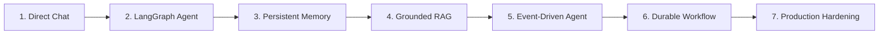
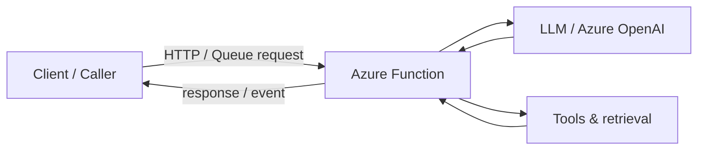

# AI & Agents

Use this category for LLM-backed endpoints, tool surfaces, and agent runtimes hosted on Azure Functions. These recipes focus on integrating model workflows with serverless execution, stateful memory, and event-driven architectures.

!!! tip "Guided Progression"
    New to building agents on Azure Functions? Follow the **[Azure-Native AI & Agent Learning Path](./learning-path.md)** to see how to progress from simple HTTP completions to stateful LangGraph agents, persistent Blob checkpoints, RAG, Service Bus event ingestion, and Durable approval workflows.

## Progression Roadmap

## Category map

## Recipe Catalog

| Recipe | Trigger | Difficulty | Focus |
| --- | --- | --- | --- |
| **[AI & Agent Learning Path](./learning-path.md)** | Overview | Guide | 7-stage architectural progression from direct chat to Durable agents |
| [Personal LangGraph Agent](./personal-langgraph-agent.md) | HTTP + LangGraphApp | Advanced | Integrated assistant with tools, deterministic tests, and persistent Blob memory |
| [Azure OpenAI Direct Chat](./openai-direct-chat.md) | HTTP + Azure OpenAI SDK | Beginner | Minimal direct chat completions endpoint |
| [LangGraph Agent](./langgraph-agent.md) | HTTP + agent graph runtime | Advanced | Compiled StateGraph mounted via azure-functions-langgraph |
| [Langgraph Tool Use](./langgraph-tool-use.md) | HTTP + LangGraph tool routing | Advanced | Tool calling with schema validation and error recovery |
| [RAG Knowledge API](./rag-knowledge-api.md) | HTTP + Azure AI Search + OpenAI | Advanced | Vector and semantic search grounding for Q&A |
| [LangGraph RAG Agent](./langgraph-rag-agent.md) | HTTP + LangGraph + Search | Advanced | LangGraph agent equipped with an AI Search retrieval tool |
| [Durable AI Pipeline](./durable-ai-pipeline.md) | HTTP + Durable Functions | Advanced | Multi-step LLM batch processing and pipeline orchestration |
| [Streaming AI Response](./streaming-ai-response.md) | HTTP + SSE streaming | Intermediate | Realtime token streaming over Server-Sent Events |
| [Embedding Vector Search](./embedding-vector-search.md) | HTTP + Azure OpenAI + AI Search | Advanced | Vector embedding generation and cosine similarity search |
| [AI Image Generation](./ai-image-generation.md) | HTTP + DALL-E 3 | Intermediate | Asynchronous image generation and blob persistence |
| [MCP Server Example](./mcp-server-example.md) | HTTP + Model Context Protocol | Intermediate | Exposing Function tools via standard MCP interfaces |
