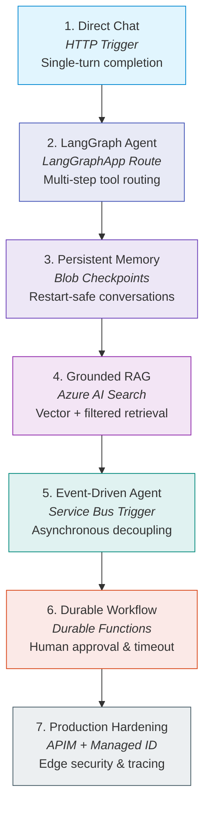

# Azure-Native AI & Agent Learning Path

This guided path traces the progression of building AI assistants and autonomous agents on Azure Functions using Python v2. It teaches how to choose the right execution model—from direct HTTP chat completions to stateful LangGraph agents, event-driven message consumers, and Durable human-in-the-loop workflows.

---

## Architectural Progression

Rather than treating AI applications as generic web servers or building monolithic showcases, compose focused architectural patterns across seven distinct stages:



---

## The 7 Progression Stages

### Stage 1: Synchronous Model Invocation (HTTP Trigger + Azure OpenAI)

* **Trigger**: HTTP (`@app.route`)
* **Underlying Service**: Azure OpenAI Service (`chat/completions`)
* **When appropriate**: Low-latency single-turn prompts, text summarization, or classification where the client waits interactively for a bounded request-response completion.
* **Execution shape**:
  ```python
  @app.route(route="chat", methods=["POST"])
  def chat(req: func.HttpRequest) -> func.HttpResponse:
      prompt = req.get_json().get("prompt")
      response = client.chat.completions.create(model="gpt-4o-mini", messages=[{"role": "user", "content": prompt}])
      return func.HttpResponse(response.choices[0].message.content)
  ```
* **Required for capability**: Azure OpenAI Python client, HTTP trigger.
* **Production upgrades**:
  - Use `DefaultAzureCredential` with Managed Identity instead of static API keys.
  - Token streaming over Server-Sent Events (SSE) to reduce perceived time-to-first-token (TTFT). Note that the cookbook recipe (`streaming_ai_response`) implements **buffered SSE**; true token-by-token streaming depends on hosting plan HTTP streaming support and gateway/proxy buffering constraints.
* **Reference recipes**:
  - [Azure OpenAI Direct Chat](openai-direct-chat.md) — clean client baseline.
  - [Streaming AI Response](streaming-ai-response.md) — buffered SSE streaming.

---

### Stage 2: Graph-Driven Routing & Tools (`LangGraphApp`)

* **Trigger**: HTTP via `azure-functions-langgraph` (`LangGraphApp`)
* **Underlying Service**: Compiled `StateGraph` + Azure OpenAI
* **When appropriate**: Dynamic reasoning, multi-turn tool calling, or branching workflows where the model decides which tools to invoke before producing an answer.
* **Why this model fits**: `LangGraphApp` mounts the compiled graph directly onto the Azure Functions routing infrastructure (`POST /api/graphs/{name}/invoke`), providing automatic request parsing, context injection, and error formatting.
* **Execution boundary**: Application logic, prompt engineering, and tool functions remain owned by your recipe; `azure-functions-langgraph` acts solely as the runtime deployment adapter.
* **Required for capability**: Compiled LangGraph graph, `azure-functions-langgraph`.
* **Production upgrades**: Enforce explicit tool timeouts, validate tool input arguments using Pydantic, and keep tools strictly read-only or idempotent.
* **Reference recipes**:
  - [LangGraph Agent](langgraph-agent.md) — compiled graph deployment.
  - [LangGraph Tool Use](langgraph-tool-use.md) — typed tool-calling pattern.

---

### Stage 3: Per-Thread Memory & Persistent Blob Checkpoints

* **Trigger**: HTTP (`LangGraphApp`) + Azure Blob Storage
* **Underlying Service**: Azure Blob Storage Container (`checkpoints`)
* **When appropriate**: Multi-turn conversational assistants where users refer to previous context across sessions, surviving Function App cold starts and worker process recycles.
* **State distinction**:
  - *In-Memory Saver*: Fast, zero-dependency local dev; checkpoints are lost when the function worker process recycles.
  - *Blob Checkpointer*: Durable state stored as blobs keyed by `thread_id`; survives cold starts and instance recycles.
* **Concurrency & locking limitations (Critical)**:
  > [!WARNING]
  > **Concurrent-Writer Hazard**: Azure Blob Storage checkpointers do not enforce distributed multi-instance write locking or optimistic concurrency out of the box. If multiple worker instances concurrently execute turns for the *same* `thread_id`, writes can race and overwrite checkpoint state (last-write-wins).
  > To serialize execution per thread in distributed environments, route concurrent requests through a single-writer queue (such as Service Bus Sessions keyed by `session_id`), or implement blob lease locking.
* **Identity boundary (Critical)**:
  > [!IMPORTANT]
  > A `thread_id` is an execution state partition key at `config.configurable.thread_id`. **It is not an authenticated user identity or security boundary.**
  > Never allow clients to supply an arbitrary `thread_id` without verifying that the authenticated caller owns that conversation thread. Always authenticate the caller (via EasyAuth or bearer token) before invoking the graph.
* **Required for capability**: Azure Blob Storage container, checkpointer package.
* **Production upgrades**: Use identity-based storage connections (`AzureWebJobsStorage__blobServiceUri`) and configure blob lifecycle policies to expire stale threads.
* **Reference recipe**:
  - [Personal LangGraph Agent](personal-langgraph-agent.md) — complete single-user personal notes assistant with memory.

---

### Stage 4: Grounded Knowledge Retrieval (Azure AI Search RAG)

* **Trigger**: HTTP (`LangGraphApp` or search endpoint)
* **Underlying Service**: Azure AI Search + Azure OpenAI Embeddings
* **When appropriate**: Answering questions against private internal documents, manuals, or catalogs without fine-tuning models.
* **Architecture flow**:
  1. Input query is converted to a vector embedding using `text-embedding-3-small`.
  2. Query is submitted to Azure AI Search for vector and filtered search retrieval.
  3. Top matching passages are injected into the agent's prompt context.
* **Why use the Azure SDK**: Querying Azure AI Search via the official `azure-search-documents` Python SDK provides direct control over vector queries, score thresholds, and metadata filters within the function execution context.
* **Required for capability**: Azure AI Search index, embedding model deployment.
* **Production upgrades**: Limit retrieved chunk count and payload size to avoid blowing model context windows; sanitize document metadata to prevent prompt injection.
* **Reference recipes**:
  - [RAG Knowledge API](rag-knowledge-api.md) — vector search knowledge endpoint.
  - [Embedding Vector Search](embedding-vector-search.md) — direct embedding generation and query.
  - [LangGraph RAG Agent](langgraph-rag-agent.md) — agent graph with search tool integration.

---

### Stage 5: Event-Driven Agent Invocation (Service Bus Decoupling)

* **Trigger**: Service Bus Queue or Topic Trigger (`@app.service_bus_queue_trigger`)
* **Underlying Service**: Azure Service Bus
* **When appropriate**:
  - Long-running or variable-latency agent tasks (e.g. multi-step tool loops or web searches) that risk HTTP client or gateway timeouts.
  - Upstream webhooks, system alerts, or asynchronous events trigger agent work.
  - Decoupling requests with durable delivery, automatic retries, and dead-letter queue (DLQ) isolation for poison messages.
* **Execution shape**:
  1. Client sends a request to an HTTP ingest endpoint; endpoint validates and enqueues a work message onto Service Bus, immediately returning `202 Accepted` with a correlation ID.
  2. A Service Bus-triggered function consumes the message, invokes the compiled LangGraph agent, and writes results to a database or notifies a webhook.
* **Why this model fits**:
  - Prevents caller timeouts while preserving at-least-once processing guarantees.
  - Provides automatic retry and dead-letter queue (DLQ) isolation for poison inputs.
  - Service Bus Sessions (`is_sessions_enabled=True`) can enforce strict FIFO ordering per `session_id` (e.g., ensuring messages for the same user or ticket process sequentially and serializing checkpoint access).
* **Implementation boundary (Standalone vs. Proposed Composition)**:
  - *Shipped Standalone Recipes*: The cookbook provides working standalone messaging recipes demonstrating reliable consumer workers ([Service Bus Worker](../messaging-and-pubsub/servicebus-worker.md)), ordered FIFO processing ([Service Bus Sessions](../messaging-and-pubsub/servicebus-sessions.md)), and error triage ([Service Bus DLQ Replay](../messaging-and-pubsub/servicebus-dlq-replay.md)).
  - *Proposed Agent Composition*: Integrating a compiled LangGraph agent directly with a Service Bus queue trigger is an architectural composition tracked under upcoming issue [#349](https://github.com/yeongseon/azure-functions-cookbook-python/issues/349).
* **Required for capability**: Service Bus namespace, Queue/Topic trigger handler.
* **Production upgrades**: Configure `maxDeliveryCount` and monitor dead-letter queues; ensure agent tool side effects are idempotent.

---

### Stage 6: Long-Running Workflows & Human Approval (Durable Functions)

* **Trigger**: Durable Orchestrator Trigger (`@bp.orchestration_trigger`)
* **Underlying Service**: Durable Task Framework + Storage Provider
* **When appropriate**:
  - Multi-step AI pipelines requiring human-in-the-loop review (e.g., approving a high-value tool action or draft before publication).
  - Long delays (waiting hours or days for user input via email or portal).
  - Parallel agent task fan-out and aggregation (e.g., analyzing 10 documents concurrently).
* **Orchestration rules**:
  > [!IMPORTANT]
  > **Durable Orchestrator Determinism**: Orchestrator functions must be deterministic because they replay history to reconstruct state.
  > **Never call LLMs, make network requests, or invoke tools directly inside orchestrator code.** Always wrap agent executions and external calls in **Durable Activity functions** (`@bp.activity_trigger`).
* **Execution flow**:
  ```
  HTTP Client ──► Starter (202 Accepted)
                     │
                     ▼
             Durable Orchestrator
                     │
                     ├─► Activity: Prepare Agent Prompt & Context
                     │
                     ├─► Activity: Run LangGraph Agent Round 1
                     │
                     ├─► waitForExternalEvent("ManagerApproval", timeout=24h)
                     │         │
                     │         ▼ (Approval received or timeout)
                     │
                     └─► Activity: Execute Final Tool Action & Publish
  ```
* **Implementation boundary (Standalone vs. Proposed Composition)**:
  - *Shipped Standalone Recipes*: The cookbook provides working standalone Durable patterns demonstrating multi-activity orchestration ([Durable AI Pipeline](durable-ai-pipeline.md)), human approval events ([Durable Human Interaction](../orchestration-and-workflows/durable-human-interaction.md)), and async status queries ([Async Job Lifecycle](../orchestration-and-workflows/async-job-lifecycle.md)).
  - *Proposed Agent Composition*: Composing compiled LangGraph agent activities with external human-approval events and compensation logic is an architectural composition tracked under upcoming issue [#350](https://github.com/yeongseon/azure-functions-cookbook-python/issues/350).
* **Required for capability**: `azure-functions-durable`, Durable Task Hub.

---

### Stage 7: Production Hardening (Edge, Identity & Observability)

Layer enterprise operational controls onto the working agent app:

```
[ Incoming Client Request ]
             │
             ▼
[ 1. API Management (APIM) ] ─────────► Ingress rate-limiting, token usage quotas, CORS
             │
             ▼
[ 2. EasyAuth / JWT Bearer ] ────────► Authenticate caller principal & tenant ID
             │
             ▼
[ 3. Function App (Agent Graph) ]
             │
             ├─► Managed Identity ────► Keyless auth to Azure OpenAI, Storage, Search
             ├─► Key Vault References ─► Third-party API keys (@Microsoft.KeyVault)
             └─► App Insights Tracing ─► Trace ID propagation & model latency telemetry
```

1. **Edge Gateway (APIM)**: Protect functions against abuse with rate limiting, subscription keys, and IP allowlists ([APIM Function Backend](../apis-and-ingress/apim-function-backend.md)).
2. **Caller Authentication**: Extract caller identity from EasyAuth headers (`X-MS-CLIENT-PRINCIPAL-NAME`) or validate bearer JWTs before allowing access to conversation checkpoints ([EasyAuth Claims Extraction](../apis-and-ingress/auth-easyauth-claims.md), [JWT Bearer Validation](../apis-and-ingress/auth-jwt-validation.md)).
3. **Keyless Resource Identity**: Connect to Azure OpenAI, Storage, and Service Bus via Managed Identity (`DefaultAzureCredential`), eliminating credential leaks ([Managed Identity Storage](../security-and-tenancy/managed-identity-storage.md)).
4. **Secretless Key Vault**: Store external third-party tool tokens in Azure Key Vault and reference them directly in application settings ([Secretless Key Vault](../security-and-tenancy/secretless-keyvault.md)).
5. **Observability & Distributed Tracing**: Correlate frontend requests with backend function invocations and model tokens using Application Insights ([Observability Tracing](../runtime-and-ops/observability-tracing.md)). Avoid logging full prompt payloads containing PII.

---

## When to Transition Between Stages

| Current Stage | Move to Next Stage When... | Next Trigger / Model |
| --- | --- | --- |
| **1. Direct Chat** | You need multi-step reasoning, external tool execution, or dynamic branching. | `LangGraphApp` route ([Stage 2](#stage-2-graph-driven-routing-tools-langgraphapp)) |
| **2. LangGraph Agent** | Conversations span multiple turns and must survive worker restarts or cold starts. | Blob checkpointer ([Stage 3](#stage-3-per-thread-memory-persistent-blob-checkpoints)) |
| **3. Memory / Checkpoints** | The agent requires external corporate knowledge, manuals, or document search. | Azure AI Search RAG ([Stage 4](#stage-4-grounded-knowledge-retrieval-azure-ai-search-rag)) |
| **4. Grounded RAG** | Execution duration threatens HTTP client/gateway timeouts, or requests originate from asynchronous events requiring at-least-once retry delivery. | Service Bus queue ([Stage 5](#stage-5-event-driven-agent-invocation-service-bus-decoupling)) |
| **5. Event-Driven Agent** | Operations require human sign-off, multi-day wait intervals, durable timers, or compensation workflows. | Durable Functions ([Stage 6](#stage-6-long-running-workflows-human-approval-durable-functions)) |
| **6. Durable Workflows** | Moving into production multi-tenant environments with strict compliance and security requirements. | Production hardening ([Stage 7](#stage-7-production-hardening-edge-identity-observability)) |

---

## Related Foundation Documents

- [Pattern Chooser](../../foundations/pattern-chooser.md) — visual decision flow for all 14 categories.
- [Execution Model](../../foundations/execution-model.md) — Python v2 programming model and Blueprints.
- [Delivery Guarantees](../../foundations/delivery-guarantees.md) — at-least-once message processing rules.
