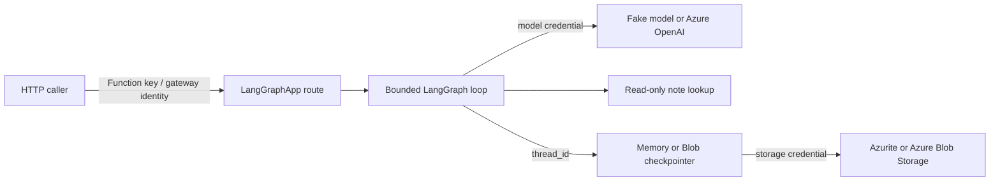

# Personal LangGraph Agent

> **Trigger**: HTTP | **State**: per-thread checkpoints | **Guarantee**: at-most-once request handling, not exactly-once tool effects | **Difficulty**: advanced

## Overview

This cumulative walkthrough builds one read-only personal notes assistant. It uses the
adapter's real `POST /api/graphs/personal_agent/invoke` route, a compiled LangGraph
model → tool → model loop, and the same graph in both memory modes. Start with a
deterministic fake model, connect Azure OpenAI, customize the prompt and typed tool,
then replace process-local checkpoints with Blob-backed checkpoints.

The default is a **single-user learning recipe**. A `thread_id` separates checkpoint
streams; it does not prove who the caller is or authorize that caller to read a thread.

## Architecture and trust boundaries



Treat the three authentication paths independently:

1. **Caller → Function**: the recipe uses `func.AuthLevel.FUNCTION`. Send the key in
   `x-functions-key` or `?code=`; never embed it in public frontend code or log it. A
   production multi-user service still needs authenticated principal-to-thread ownership
   checks on every enabled route.
2. **Function → model**: local development can use an Azure OpenAI API key. Production
   should use the Function App's managed identity through `DefaultAzureCredential`.
3. **Function → storage**: Azurite uses its development connection string. A production
   account should use a narrowly scoped managed identity where your storage construction
   supports token credentials; do not reuse the model credential or expose a storage key
   to callers.

## State vocabulary

These layers solve different problems:

| Layer | Meaning |
| --- | --- |
| **Model context** | The messages supplied to one model invocation. The graph rebuilds it from the current checkpoint plus the new input. |
| **Checkpointer** | Saves graph state between invocations. `InMemorySaver` is process-local; the Blob saver survives process recreation. |
| **Thread ID** | A caller-supplied checkpoint partition key at `config.configurable.thread_id`. It is not a user identity, secret, or authorization decision. |
| **Platform ThreadStore** | An optional platform-level thread metadata/history service. It is separate from the graph checkpointer and is not required by this recipe. |

## Project structure

```text
examples/ai-and-agents/personal_langgraph_agent/
├── app/core/settings.py       # explicit model, timeout, and memory settings
├── app/core/model.py          # deterministic fake and Azure OpenAI construction
├── app/services/graph.py      # prompt, bounded tool loop, and graph factory
├── app/services/notes.py      # typed, read-only replaceable tool
├── function_app.py            # checkpointer/lock wiring and LangGraphApp export
├── local.settings.json.example
├── pyproject.toml
└── requirements.txt
```

## Stage 1: run locally with the fake model

The fake replaces only the external model. The compiled LangGraph graph, tool call,
checkpointer, and Azure Functions adapter are real.

```bash
cd examples/ai-and-agents/personal_langgraph_agent
uv venv
uv pip install --python .venv/bin/python -r requirements.txt
uv pip check --python .venv/bin/python
cp local.settings.json.example local.settings.json
func start
```

The discovered route is:

```text
POST http://localhost:7071/api/graphs/personal_agent/invoke
```

Core Tools normally permits local requests without a key. If your host requires one,
export `FUNCTION_KEY` and add `-H "x-functions-key: $FUNCTION_KEY"` to each request.

First turn:

```bash
curl --fail-with-body -sS \
  -X POST http://localhost:7071/api/graphs/personal_agent/invoke \
  -H 'Content-Type: application/json' \
  -d '{
    "input": {"messages": [{"role": "human", "content": "What is planned for Project Atlas?"}]},
    "config": {"configurable": {"thread_id": "atlas-demo"}}
  }' | jq '{messages: [.output.messages[] | {type, content}]}'
```

Normalized deterministic output (transport IDs and metadata are intentionally removed):

```json
{
  "messages": [
    {"type": "human", "content": "What is planned for Project Atlas?"},
    {"type": "ai", "content": ""},
    {"type": "tool", "content": "Project Atlas: prepare the launch checklist by Friday. [sample data]"},
    {"type": "ai", "content": "[fake model] lookup_notes(query='Project Atlas') returned: Project Atlas: prepare the launch checklist by Friday. [sample data]; human_turns=1"}
  ]
}
```

## Stage 2: connect a real model

Set real mode explicitly. It never falls back to fake output when configuration is
incomplete; startup lists missing setting **names**, never secret values.

Local API-key configuration:

```text
AGENT_MODEL_MODE=azure_openai
AZURE_OPENAI_ENDPOINT=https://YOUR-RESOURCE.openai.azure.com/
AZURE_OPENAI_DEPLOYMENT=YOUR-CHAT-DEPLOYMENT
AZURE_OPENAI_API_KEY=YOUR-LOCAL-SECRET
```

Entra ID / Managed Identity configuration:

```text
AGENT_MODEL_MODE=azure_openai
AZURE_OPENAI_ENDPOINT=https://YOUR-RESOURCE.openai.azure.com/
AZURE_OPENAI_DEPLOYMENT=YOUR-CHAT-DEPLOYMENT
AZURE_OPENAI_USE_ENTRA_ID=true
```

Grant the Function App identity **Cognitive Services OpenAI User** on the Azure OpenAI
resource. `DefaultAzureCredential` supports a signed-in developer locally and managed
identity after deployment. Real-model wording is nondeterministic; the expected behavior
is illustrative: the model calls `lookup_notes` with `Project Atlas`, then answers from the
labelled sample result rather than inventing another note.

## Stage 3: personalize the prompt and tool

- Edit `SYSTEM_PROMPT` in `app/services/graph.py` for tone and policy.
- Replace `SampleNoteLookup` in `app/services/notes.py` with your authorized API client.
  Keep the `NoteLookup` contract typed, validate API input at its boundary, use a bounded
  downstream timeout, and start with read-only actions.
- If you rename the tool, update `PERSONAL_AGENT_FAKE_TOOL_NAME`. Fake mode deliberately
  fails at startup when its scripted tool name no longer matches the graph.

The bundled records are visibly marked `[sample data]`. Do not turn a personal access token
or broad service credential into a shared tool identity; authorize the downstream request
for the intended principal before claiming multi-user isolation.

## Stage 4: keep conversation memory

The default `AGENT_MEMORY_MODE=memory` compiles the graph with `InMemorySaver`. Reuse the
exact thread path for a follow-up:

```bash
curl --fail-with-body -sS \
  -X POST http://localhost:7071/api/graphs/personal_agent/invoke \
  -H 'Content-Type: application/json' \
  -d '{
    "input": {"messages": [{"role": "human", "content": "Check it again."}]},
    "config": {"configurable": {"thread_id": "atlas-demo"}}
  }' | jq -r '.output.messages | map(select(.type == "ai")) | last.content'
```

The fake output ends with `human_turns=2`. A separate thread stays isolated:

```bash
curl --fail-with-body -sS \
  -X POST http://localhost:7071/api/graphs/personal_agent/invoke \
  -H 'Content-Type: application/json' \
  -d '{
    "input": {"messages": [{"role": "human", "content": "Check Project Atlas."}]},
    "config": {"configurable": {"thread_id": "separate-demo"}}
  }' | jq -r '.output.messages | map(select(.type == "ai")) | last.content'
```

That output ends with `human_turns=1`. This proves checkpoint separation, **not**
authenticated user ownership. In-memory state disappears on host restart and is not shared
between scaled-out worker processes.

## Stage 5: persist memory with Azurite or Blob Storage

Keep `app/services/graph.py`, the model, and tools unchanged. Start Azurite and change only
the persistence wiring through settings:

```text
AGENT_MEMORY_MODE=blob
AZURE_STORAGE_CONNECTION_STRING=UseDevelopmentStorage=true
LANGGRAPH_AUTO_CREATE_STORAGE=true
LANGGRAPH_BLOB_CONTAINER=personal-agent-checkpoints
AZFUNC_LANGGRAPH_LOCK_BACKEND=distributed
```

`function_app.py` then uses `AzureBlobCheckpointSaver` and
`AzureBlobLeaseThreadLock`. Invoke once, stop and restart the Function host, then invoke a
follow-up with the same thread ID. The normalized fake response should end in
`human_turns=2`.

For an automated recreation proof, run the e2e test. It starts Azurite itself, so the
`azurite` executable must be on `PATH`:

```bash
hatch run pytest -m e2e tests/e2e/test_personal_agent_azurite.py --no-cov
```

The test creates a unique container, invokes one app/checkpointer, recreates both, and
asserts the second invocation sees the earlier turn. It fails, rather than skips, when
Azurite cannot start. The repository unit suite exercises
the registered handler directly; a real Functions-host smoke was **not executed for this
walkthrough**, and Azure Blob host-restart verification remains an optional cloud procedure.

For Azure Storage, use a dedicated container and least-privilege data-plane role. The
checked-in wiring consumes `AZURE_STORAGE_CONNECTION_STRING`; replacing that construction
with `ContainerClient(account_url=..., credential=DefaultAzureCredential())` is the
recommended managed-identity adaptation. Validate it in your environment before claiming
cloud verification.

The distributed lease serializes same-thread checkpoint writes across instances. Lease
expiry and cancellation can still occur, and neither the lock nor checkpointer makes tool
side effects exactly once. This recipe therefore keeps its tool read-only.

## Stage 6: deploy and diagnose

Deploy with your normal Function App workflow, set app settings in the platform rather than
committing secrets, and verify the route reported by Core Tools or the Azure portal. A
deployed request uses a Function key:

```bash
curl --fail-with-body -sS \
  -X POST "https://YOUR-APP.azurewebsites.net/api/graphs/personal_agent/invoke" \
  -H "x-functions-key: $FUNCTION_KEY" \
  -H 'Content-Type: application/json' \
  -d '{
    "input": {"messages": [{"role": "human", "content": "What is planned for Project Atlas?"}]},
    "config": {"configurable": {"thread_id": "production-diagnostic"}}
  }'
```

Cloud deployment, managed-identity access, and a live Azure OpenAI call were **not executed
as part of this recipe verification**. Treat the command as a deployment procedure, not as
recorded certification.

Diagnosis checklist:

- A startup failure names missing Azure OpenAI or Blob settings; it does not silently
  switch modes.
- A `401`/`403` at the Function route is caller authentication. An Azure OpenAI `401`/`403`
  is model identity/RBAC. A Blob `403` is storage identity/RBAC. Debug them separately.
- Correlate by safe invocation/run/thread identifiers and outcome. `LoggingRunObserver`
  does not log message text, tool arguments, checkpoint contents, keys, or credentials by
  default.
- Model calls are bounded by `AGENT_MODEL_TIMEOUT_SECONDS` (default 30 seconds), tools by
  `AGENT_TOOL_TIMEOUT_SECONDS` (default 5 seconds), tool rounds by `MAX_TOOL_ROUNDS=2`, and
  graph recursion by an application-owned limit. Request config cannot raise that limit.

Azure OpenAI charges for model/token usage; Blob Storage charges for capacity and
transactions; Function hosting may also incur cost. Costs vary by region, model, and plan,
so this recipe makes no fixed-price claim. Delete the test Function App/resource group,
model deployment, storage container/account, and local Azurite data when finished. Apply
retention and lifecycle rules before retaining real checkpoint data.

## Choosing among the LangGraph recipes

- [LangGraph Agent](langgraph-agent.md): focused adapter registration plus a deterministic
  manual HTTP facade; it does not execute the registered graph from that facade.
- [Langgraph Tool Use](langgraph-tool-use.md): focused deterministic routing; no
  checkpoint-backed conversation memory.
- [LangGraph RAG Agent](langgraph-rag-agent.md): focused retrieval composition.
- **This recipe**: the integrated real adapter route, model-selected typed tool, same-thread
  memory, and optional restart-safe Blob checkpoints.
- [Adapter minimal examples](https://github.com/yeongseon/azure-functions-langgraph-python/tree/main/examples):
  small, capability-focused registration, memory, tool-calling, and persistence examples.
  They are intentionally not one cumulative application.
- [Adapter documentation issue #625](https://github.com/yeongseon/azure-functions-langgraph-python/issues/625):
  tracks corrected learning-path wording and the cross-link back to this cookbook recipe.

## Related links

- [Runnable recipe source](https://github.com/yeongseon/azure-functions-cookbook-python/tree/main/examples/ai-and-agents/personal_langgraph_agent)
- [Integrated recipe issue #343](https://github.com/yeongseon/azure-functions-cookbook-python/issues/343)
- [Azure Functions deployment guide](../../guides/deployment-patterns.md)
- [Identity-based connections](../../guides/identity-based-connections.md)
- [Azure Storage lifecycle management](https://learn.microsoft.com/azure/storage/blobs/lifecycle-management-overview)
