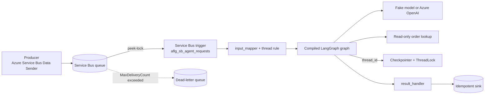

# Service Bus LangGraph Agent

> **Trigger**: Service Bus queue | **State**: per-thread checkpoints | **Guarantee**: at-least-once delivery, idempotent state and sink, not exactly-once side effects | **Difficulty**: advanced

## Overview

A caller or upstream system submits a work item to a Service Bus queue. Service Bus holds it
durably; a Service Bus-triggered Function maps it to a graph input and thread, runs a real
compiled LangGraph graph, and records the outcome. Nobody holds an HTTP request open.

The recipe uses `LangGraphApp.register_service_bus(...)` from `azure-functions-langgraph`
and does not reimplement the trigger. Retry and dead-lettering stay with Service Bus and the
Functions host.

> [!IMPORTANT]
> The adapter's Service Bus surface is documented by that package as **experimental**: it is
> opt-in and may change between minor releases. The recipe pins `>=0.13.0,<0.14` and uses only
> what the released 0.13.0 wheel provides (`session`, `session_exclusive`, `thread_id_factory`,
> `result_handler`, `lock_timeout`). It enables `session=True` as an option and does **not**
> enable `session_exclusive`.

> [!NOTE]
> **Verification level: unit.** Offline tests call the real generated handler with real
> `azure.functions` Service Bus message objects. No Functions host, Service Bus namespace,
> Azure OpenAI call or Azure deployment has verified this recipe, and nothing here is certified.

## When a message trigger beats HTTP

| | HTTP (`register`) | Service Bus (`register_service_bus`) |
| --- | --- | --- |
| Caller waits for the answer | Yes | No; results go to a sink you own |
| Work longer than a request timeout | Awkward | Natural, within the lock and function timeout limits |
| Producer/consumer decoupling and buffering | No | Yes (queue) |
| Delivery | Caller retries | At-least-once; broker redelivers |

Use HTTP when the caller needs the answer in the same call. Use a message when the work can
be queued, retried and answered asynchronously. Work that must outlive a Function execution,
or wait for approval, is a Durable Functions problem and is out of scope here.

## Architecture



## Message to graph input

The body is JSON: `request_id` and `question` required, `conversation_id` optional.
`app/contract.py` validates it (size, types, ID shape) and raises `InvalidMessageError` naming
the field, never the value. The human message gets `id = "<request_id>:question"`.

A malformed body cannot be repaired by redelivery. It is retried until `MaxDeliveryCount`
(default 10, per the [Service Bus dead-letter documentation][dlq]) and then dead-lettered.
Validate producers upstream and inspect the dead-letter queue with the
[DLQ Replay](../messaging-and-pubsub/servicebus-dlq-replay.md) recipe.

## Message to thread mapping

| Mode | Thread ID |
| --- | --- |
| Queue or topic subscription, `conversation_id` present | `sb:conversation:<conversation_id>` |
| Queue or topic subscription, no `conversation_id` | `sb:request:<request_id>` (one thread per request) |
| `session=True` | the message `session_id`, required |

In session mode the adapter requires a non-empty `session_id` and uses it as the thread ID;
a `thread_id_factory` may only repeat it, so the recipe supplies none. The prefixes keep
Service Bus threads apart from HTTP thread IDs.

> [!WARNING]
> A thread ID is a checkpoint partition key. A producer who can guess or choose a
> `conversation_id` or `session_id` can write into that thread. The boundary is
> Service Bus authorization (who holds the sender role on the queue), not the ID. Do not put
> user-private data into a thread a different sender could address.

Run correlation comes from the adapter's `RunContext`: `trigger_type="service_bus"`,
`invocation_id` set to the Service Bus `message_id`, and the thread ID. `LoggingRunObserver`
emits them without bodies or prompts.

## Idempotency under redelivery

Service Bus peek-lock delivery is at-least-once: lock expiry, a crashed instance or an
abandon redelivers the message, and the adapter adds no deduplication. The recipe makes the
*observable* effects idempotent instead of claiming exactly-once:

- Every message the graph adds has an ID derived from `request_id` (`:question`, `:agent`,
  `:tool:<n>`, `:final`). LangGraph's `add_messages` reducer replaces a message with an
  existing ID.
- A completed request is skipped. A request interrupted mid-run is rewritten from its own
  question; leftovers of the earlier attempt are removed.
- The result handler upserts by `request_id` (`InMemoryOutcomeStore` stands in for a durable
  upsert). An append-only sink would record duplicates.
- The only tool is read-only. A tool with side effects needs its own idempotency key
  (for example the `request_id`); the broker cannot provide one.

Tests cover redelivery of a completed request and redelivery after a mid-run failure.
Sender-side [duplicate detection][dedupe] on the queue is a separate, complementary control;
it depends on producers choosing a stable `MessageId`.

## Retry, dead-letter and lock scope

Per the [Functions Service Bus trigger documentation][trigger], the runtime receives messages
in PeekLock mode, completes the message when the function succeeds and abandons it when the
function fails (`autoCompleteMessages` defaults to `true`). The recipe never settles messages
itself; every failure is an exception:

| Failure | Result |
| --- | --- |
| Invalid body, unknown tool, model timeout, sink error | Exception, message abandoned, redelivered |
| Same thread still locked by another delivery | `ThreadContentionError`, abandoned, redelivered |
| Repeated failures | Dead-lettered after `MaxDeliveryCount` |

Thread contention burns delivery count. Prefer sessions for ordered per-conversation work so
the broker serializes a session; sessions follow the broker semantics in the
[Service Bus sessions documentation][sessions]. Whether a session lock is held through the
whole execution is the operator's assertion to make for `session_exclusive`; this recipe
leaves that off and keeps the adapter's `ThreadLock`.

Budget `lock_timeout` + model/tool time + sink time inside the message lock (default one
minute, at most five minutes before renewal is needed, per the
[locks documentation][locks]), `maxAutoLockRenewalDuration` and `functionTimeout`. The
checked-in `host.json` sets 5 minutes for both, `maxConcurrentCalls` to 4 and
`maxConcurrentSessions` to 4 (see the [host.json reference][hostjson]); tune them to your model
latency. The adapter does not renew broker locks.

Existing recipes cover the dedicated mechanics:
[Service Bus Worker](../messaging-and-pubsub/servicebus-worker.md),
[Service Bus Sessions](../messaging-and-pubsub/servicebus-sessions.md),
[Service Bus Topic Fan-out](../messaging-and-pubsub/servicebus-topic-fanout.md),
[Service Bus DLQ Replay](../messaging-and-pubsub/servicebus-dlq-replay.md) and
[Poison Message Handling](../reliability/poison-message-handling.md).

## Queue, sessions or topic subscription

- **Queue**: one consumer group competes for each message. Default choice for independent
  work items.
- **Queue with sessions**: messages sharing a `session_id` are processed in order by one
  receiver at a time. Choose it when turns of one conversation must not run concurrently.
  Set `SERVICEBUS_SESSIONS=true`; the queue must be created with sessions enabled.
- **Topic + subscription**: each subscription gets its own copy. Choose it to fan one event
  out to several independent consumers. `register_service_bus` supports it via
  `topic_name` and `subscription_name`; this recipe wires the queue form only. See the
  fan-out recipe.

## Identity and secrets

The trigger's `connection` names an app-setting prefix. For production use the identity-based
form: `ServiceBusConnection__fullyQualifiedNamespace` plus the Function App's managed
identity, and no connection string. The built-in roles are documented in
[Service Bus managed identity][msi]: **Azure Service Bus Data Sender** lets producers send,
**Azure Service Bus Data Receiver** lets the Function receive. The Functions documentation
adds that **Azure Service Bus Data Owner** (or a custom role with
`Microsoft.ServiceBus/namespaces/*/read`) is needed for accurate scale decisions; without it
the extension falls back to less accurate peek-based estimates (see [connections][trigger]).
Local development uses a connection string in `local.settings.json` (never committed); a
Service Bus emulator is not covered. Details: [Managed Identity Service Bus](../security-and-tenancy/managed-identity-servicebus.md).

For live model mode use `AZURE_OPENAI_USE_ENTRA_ID=true` with **Cognitive Services OpenAI
User**; the API key path is for local development. See the
[Personal LangGraph Agent](personal-langgraph-agent.md) for the same model settings.

## Telemetry and privacy

Logged: `request_id`, Service Bus `message_id`, delivery count, thread ID, outcome and answer
length. Not logged by default: the question, the answer, the body, credentials. Tests assert
this. Trace and metric export is covered by
[Observability Tracing](../runtime-and-ops/observability-tracing.md); do not add prompts to
span attributes without a retention decision.

## Run it

Offline (no Azure, no Service Bus, no credential):

```bash
cd examples/ai-and-agents/servicebus_langgraph_agent
uv venv
uv pip install --python .venv/bin/python -e ".[dev]"
.venv/bin/python -m pytest
```

With Core Tools, Azurite and a Service Bus queue: copy `local.settings.json.example`, set
`ServiceBusConnection`, run `func start`, then send
`{"request_id": "req-1", "question": "Where is order A-1001?"}`.

## What is not verified

- No Functions host run and no real Service Bus delivery, lock expiry, abandon or
  dead-lettering has been exercised; those behaviors are described from the cited Microsoft
  documentation and the adapter's source and docs.
- Session behavior is checked only through the adapter's offline handler path, not against a
  session-enabled queue.
- Azure OpenAI live mode and managed-identity access were not exercised.
- Because the recipe is not in the host-smoke matrix, `verification` stays `unit`; promote it
  only together with a real host run and the host-smoke conventions.

## Related links

- [Runnable recipe source](https://github.com/yeongseon/azure-functions-cookbook-python/tree/main/examples/ai-and-agents/servicebus_langgraph_agent)
- [Issue #349](https://github.com/yeongseon/azure-functions-cookbook-python/issues/349)
- [azure-functions-langgraph](https://github.com/yeongseon/azure-functions-langgraph-python) `service_bus_agent` and `service_bus_sessions` examples
- [Service Bus trigger for Azure Functions][trigger]

[trigger]: https://learn.microsoft.com/azure/azure-functions/functions-bindings-service-bus-trigger
[hostjson]: https://learn.microsoft.com/azure/azure-functions/functions-bindings-service-bus#hostjson-settings
[dlq]: https://learn.microsoft.com/azure/service-bus-messaging/service-bus-dead-letter-queues#maximum-delivery-count
[sessions]: https://learn.microsoft.com/azure/service-bus-messaging/message-sessions
[locks]: https://learn.microsoft.com/azure/service-bus-messaging/message-transfers-locks-settlement
[dedupe]: https://learn.microsoft.com/azure/service-bus-messaging/duplicate-detection
[msi]: https://learn.microsoft.com/azure/service-bus-messaging/service-bus-managed-service-identity
